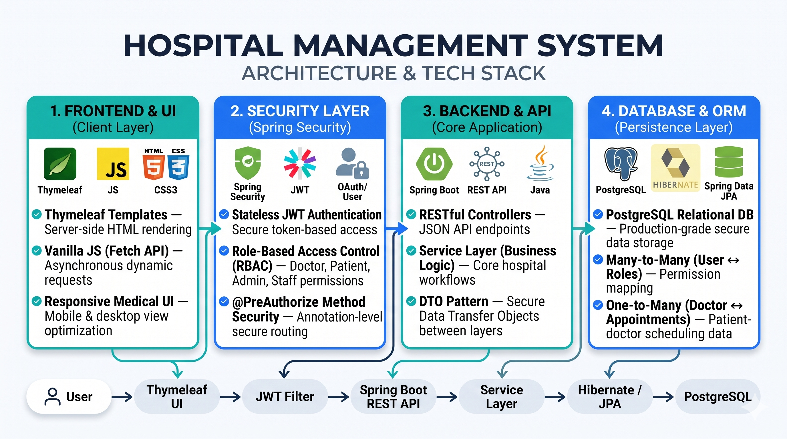
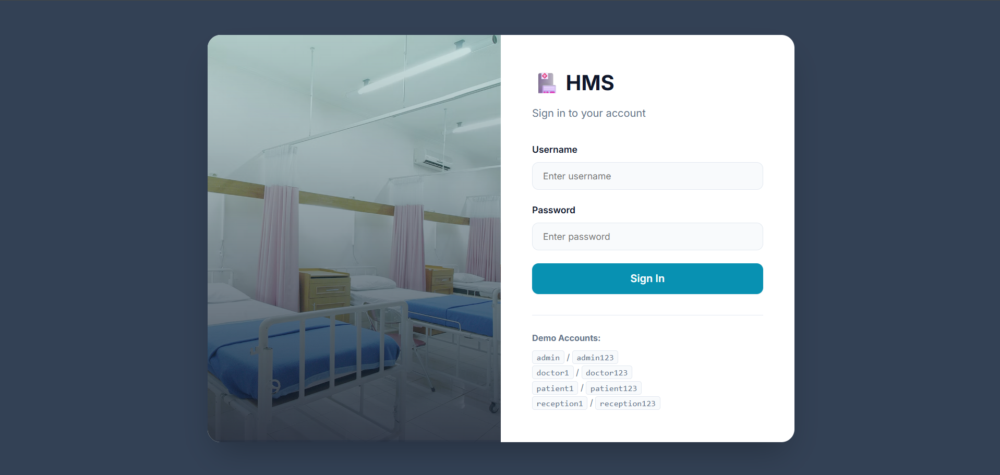
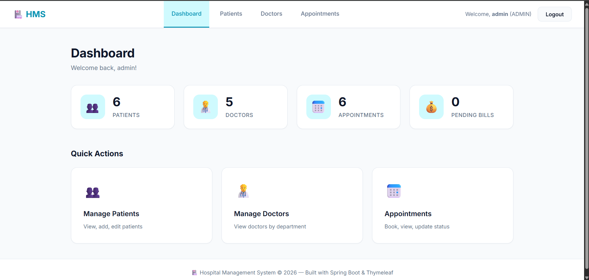
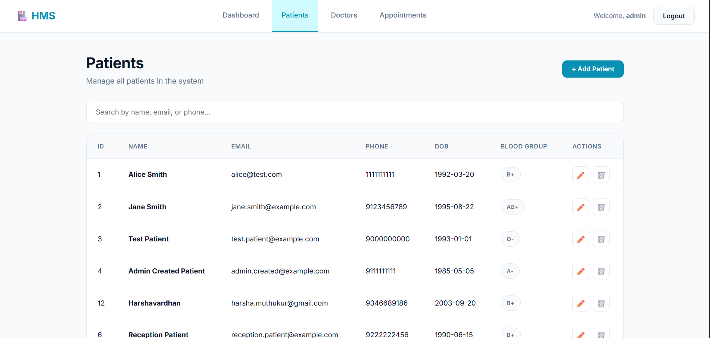
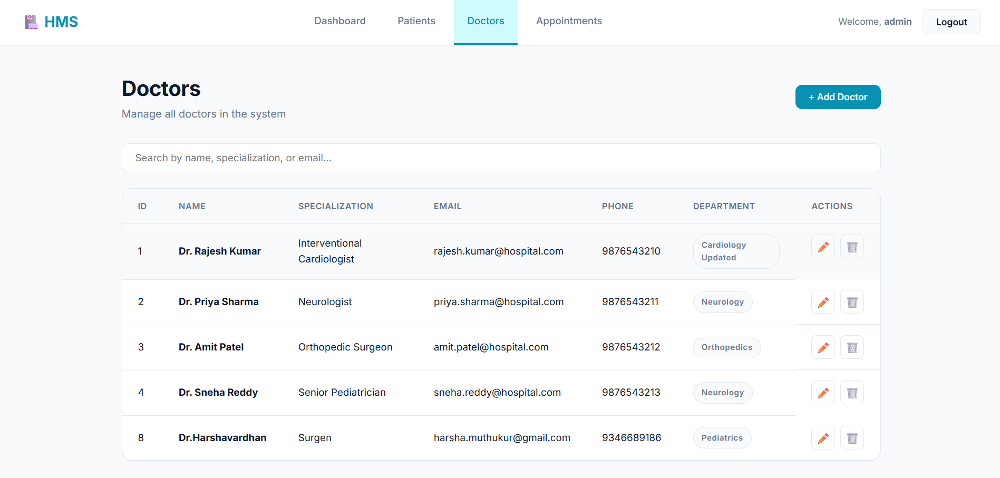
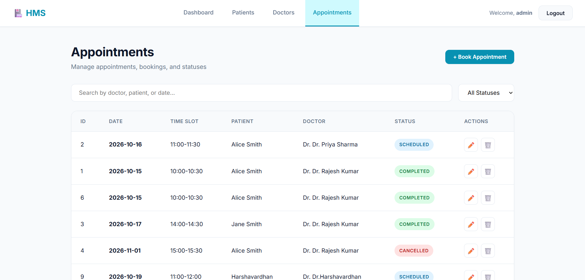
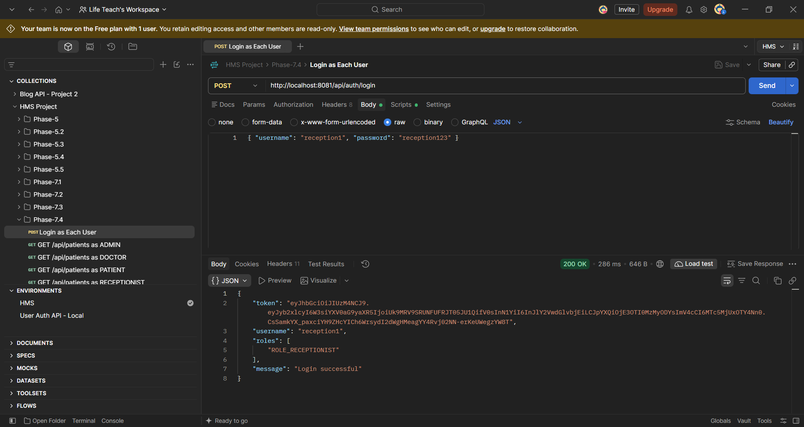

# 🏥 Hospital Management System (HMS)

A comprehensive, full-stack Hospital Management System built with **Spring Boot 3**, **Spring Security (JWT)**, **Thymeleaf**, and **PostgreSQL**.

This project demonstrates enterprise-level backend architecture, robust role-based access control (RBAC), and a modern, responsive frontend—all deployed as a single monolithic application.

---

## 🏗️ Project Workflow & Architecture

The system follows a modern N-Tier architecture with a secure JWT authentication layer and a layered backend.



---

## 📸 Interface Preview

| 🔐 Login | 📊 Dashboard |
|:---:|:---:|
|  |  |

| 👥 Patients | 👨‍⚕️ Doctors |
|:---:|:---:|
|  |  |

| 📅 Appointments | 🧪 Postman Testing |
|:---:|:---:|
|  |  |

---

## ✨ Key Features

- **Full-Stack SPA Feel:** Thymeleaf serves the views, while Vanilla JS (Fetch API) handles asynchronous data fetching and DOM manipulation.
- **Stateless JWT Authentication:** Secure login flow returning HTTP-only JSON Web Tokens.
- **Granular Role-Based Access Control (RBAC):**
  - `ADMIN`: Full access to all CRUD operations.
  - `RECEPTIONIST`: Can manage patients and appointments.
  - `DOCTOR`: Can manage medical records and update appointment statuses.
  - `PATIENT`: Read-only access to their own data (API level).
- **Business Logic Enforcement:**
  - Prevents double-booking (same doctor, date, and time slot).
  - Enforces one-to-one mapping between an Appointment and a Bill.
  - Prevents deletion of Patients with active Appointments (Foreign Key integrity).
- **Global Exception Handling:** Custom `@RestControllerAdvice` that catches validation errors, 401s, 403s, and 404s, returning clean JSON payloads.

---

## 🏗️ System Architecture & Project Structure

The application follows a classic N-Tier layered architecture.

```text
src/main/java/com/hospital/hms/
│
├── config/                  # Security and Data Seeding configurations
│   ├── SecurityConfig.java
│   └── DataInitializer.java
│
├── controller/              # REST API Endpoints
│   ├── AuthController.java
│   ├── PatientController.java
│   ├── DoctorController.java
│   ├── DepartmentController.java
│   ├── AppointmentController.java
│   ├── MedicalRecordController.java
│   ├── BillController.java
│   └── PageController.java  # Thymeleaf routing
│
├── dto/                     # Data Transfer Objects (Requests/Responses)
│   ├── LoginRequest.java
│   ├── PatientDTO.java
│   └── ...
│
├── entity/                  # JPA/Hibernate Database Models
│   ├── User.java
│   ├── Role.java
│   ├── Patient.java
│   ├── Doctor.java
│   ├── Department.java
│   ├── Appointment.java
│   ├── MedicalRecord.java
│   └── Bill.java
│
├── exception/               # Global Error Handling
│   ├── GlobalExceptionHandler.java
│   ├── ErrorResponse.java
│   └── ResourceNotFoundException.java
│
├── repository/              # Spring Data JPA Interfaces
│   └── ... (8 repositories)
│
├── security/                # JWT Implementation
│   ├── JwtService.java
│   ├── JwtAuthenticationFilter.java
│   └── CustomUserDetailsService.java
│
└── service/                 # Core Business Logic
    └── ... (7 services)
```

---

## 🗄️ Database Schema (ER Diagram)

The database is managed by Hibernate (`ddl-auto=update`). Here is the relational mapping:

- **User ↔ Role:** Many-to-Many (`user_roles` join table).
- **Doctor ↔ Department:** Many-to-One.
- **Appointment ↔ Doctor:** Many-to-One.
- **Appointment ↔ Patient:** Many-to-One.
- **MedicalRecord ↔ Patient/Doctor:** Many-to-One.
- **Bill ↔ Appointment:** One-to-One (Unique constraint).

---

## 🛠️ Tech Stack

| Layer | Technology |
|---|---|
| **Backend** | Java 17, Spring Boot 3.3.5 |
| **Security** | Spring Security 6, JJWT (JSON Web Tokens) |
| **Database** | PostgreSQL, Spring Data JPA, Hibernate 6 |
| **Frontend** | Thymeleaf, Vanilla JS (Fetch API), Custom CSS |
| **Build Tool** | Maven |
| **API Testing** | Postman |

---

## 🚀 Getting Started

### 1. Prerequisites

- Java 17+
- PostgreSQL (running locally on port 5432)
- Maven

### 2. Database Setup

Create a database named `hms_db`:

```sql
CREATE DATABASE hms_db;
```

### 3. Configure Application

Open `src/main/resources/application.properties` and update your DB credentials:

```properties
spring.datasource.url=jdbc:postgresql://localhost:5432/hms_db
spring.datasource.username=YOUR_DB_USERNAME
spring.datasource.password=YOUR_DB_PASSWORD
```

### 4. Run the Application

Run the Spring Boot application using Maven:

```bash
mvn spring-boot:run
```

The app will start on [http://localhost:8081](http://localhost:8081).

### 5. Default Demo Accounts

The `DataInitializer` automatically seeds these accounts on startup:

| Role | Username | Password |
|---|---|---|
| Admin | `admin` | `admin123` |
| Doctor | `doctor1` | `doctor123` |
| Patient | `patient1` | `patient123` |
| Receptionist | `reception1` | `reception123` |

---

## 🧪 API Testing with Postman

A complete Postman collection and environment are included in the repository root.

1. Import `HMS.postman_collection.json`.
2. Import `HMS.postman_environment.json`.
3. Run the Login request. The environment script will automatically save your JWT token.
4. Test the endpoints based on the role matrix below.

### Role Permission Matrix

| Action | ADMIN | RECEPTIONIST | DOCTOR | PATIENT |
|---|:---:|:---:|:---:|:---:|
| Login | ✅ | ✅ | ✅ | ✅ |
| Read Data (GET) | ✅ | ✅ | ✅ | ✅ |
| Create/Edit Patient | ✅ | ✅ | ❌ | ❌ |
| Delete Patient | ✅ | ❌ | ❌ | ❌ |
| Create/Edit Doctor | ✅ | ❌ | ❌ | ❌ |
| Book Appointment | ✅ | ✅ | ❌ | ❌ |
| Create Medical Record | ✅ | ❌ | ✅ | ❌ |
| Generate Bill | ✅ | ✅ | ❌ | ❌ |

---

## 🧠 Architecture Decisions & Learnings

- **DTO Pattern:** Entities are never returned in API responses. This prevents infinite recursion in bidirectional relationships and hides sensitive data (like password hashes).

- **FetchType.EAGER:** Used for `@ManyToOne` relationships in this project to prevent `LazyInitializationException` during DTO mapping, since the dataset is small.

- **Stateless Security:** No HTTP sessions are created. Every request is validated by the `JwtAuthenticationFilter`.

- **Exception Handling:** `AccessDeniedException` is handled in both `SecurityConfig` (for filter-level blocks) and `GlobalExceptionHandler` (for `@PreAuthorize` blocks) to ensure consistent JSON 403 responses.

- **Passwords are hashed using BCrypt:** Secure password storage using `BCryptPasswordEncoder`.

- **Input Validation:** Implemented Bean Validation (`@Valid`, `@NotBlank`, `@Email`) across DTOs.

---

## 📚 Project Defense & Interview Q&A

Planning to interview me? Check out [INTERVIEW_QA.md](INTERVIEW_QA.md) to see how I defend my architectural decisions, handle edge cases, and discuss scaling this application.

---

## 👤 Author

**Harsha Vardhan**

- GitHub: [@Harshavardhan3535](https://github.com/Harshavardhan3535)
- LinkedIn: [Harsha Vardhan](https://www.linkedin.com/in/harsha-vardhan-6367bb28b)

---

⭐ *If you found this project helpful or interesting, please give it a star!*
